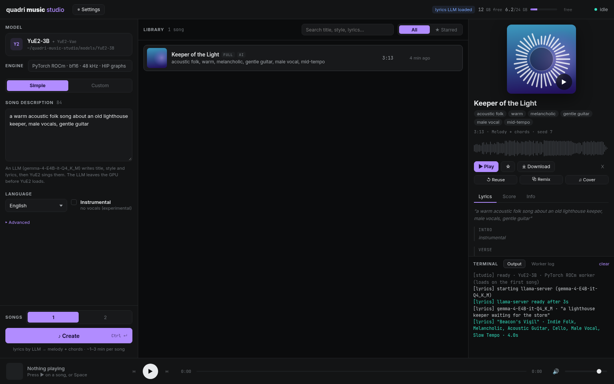

# Quadri Music Studio

**A Suno-style song studio for YuE2-3B on your own GPU: AMD (ROCm) or NVIDIA (CUDA).**

Describe a song and get a full track with vocals: an LLM writes the title, style and lyrics, then
[YuE2-3B](https://huggingface.co/m-a-p/YuE2-3B) composes a score, sings it and renders 48 kHz stereo. Or write the
lyrics and style yourself. Everything runs locally in a web app; nothing leaves your machine.



- **Simple** mode (describe it) and **Custom** mode (your lyrics + style tags, section buttons, "Write with AI").
- Watch the song being made: the score streams in while YuE2 composes, then singing and rendering progress.
- Library with search and favourites, a player with waveform, sheet music of every song (ABC → notation).
- Remix or cover a song from its score, two takes per click, FLAC / MP3 / WAV / ABC downloads.

Code: MIT. **The YuE2 models are under [CC BY-NC 4.0](https://huggingface.co/m-a-p/YuE2-3B) (no commercial use).**
The bundled lyrics writer is [Gemma 4 26B-A4B QAT Uncensored](https://huggingface.co/HauhauCS/Gemma4-26B-A4B-QAT-Uncensored-HauhauCS-Balanced-MTP)
by HauhauCS (Gemma license) on llama.cpp: a mixture-of-experts model with 4B active parameters, so it writes
fast, and it doesn't refuse dark or explicit song topics. The installer downloads the models from Hugging Face.

## Installation

Requirements: Linux or Windows 10/11 (x86-64), an AMD Radeon RX 7000/9000 or NVIDIA RTX card with **16 GB VRAM or
more** (YuE2 peaks at 11–14 GB; developed on 24 GB), 32 GB RAM, ~50 GB free disk. No Python, ROCm or CUDA install needed: the installer
brings its own.

```bash
git clone https://github.com/flaser381/quadri-music-studio.git
cd quadri-music-studio
./install.sh      # Windows: install.bat
./start.sh        # Windows: start.bat  → opens http://localhost:8096
```

The installer puts everything into the folder: a portable Node.js (if yours is older than 23.6), Python 3.13 with
PyTorch 2.10 for your GPU, YuE2-3B + YuE2-Vae (7.8 GB), llama.cpp and the lyrics model (16.8 GB), all
checksum-verified. Interrupted downloads resume when you run it again. `./install.sh --help` lists the options.

With less than ~20 GB VRAM, install with `--small-lyrics-llm`: Gemma 4 E4B (5 GB, Apache 2.0) instead. The big one
still works there, llama.cpp then keeps part of it on the CPU, but it's slower. `--no-lyrics-llm` skips the
lyrics writer.

- **Linux + AMD:** add yourself to the `render` and `video` groups (`sudo usermod -aG render,video $USER`, then log
  in again). The lyrics writer needs the Vulkan loader and Mesa drivers (`vulkan-loader`/`libvulkan1`,
  `mesa-vulkan-drivers`).
- **NVIDIA:** a driver ≥ 570 (CUDA 12.8). For older drivers: `./install.sh --torch-index https://download.pytorch.org/whl/cu126`.
- **Windows + AMD** uses AMD's TheRock PyTorch wheels and is experimental.
- **MP3 / WAV** downloads need `ffmpeg` on the PATH; FLAC always works.

Updating: `git pull && ./install.sh`. Uninstalling: delete the folder (your songs are in `data/songs/`).

## Lyrics writer

Simple mode and "Write with AI" need an LLM. By default the studio starts its own llama-server with Gemma 4
26B-A4B Uncensored when lyrics are needed and stops it before YuE2 sings, so the two never compete for VRAM.
Loading takes a few seconds, writing a song's lyrics about as long. To use a model you
already run, set `LLM_SERVER=` (empty) and point `LLM_URL` at any OpenAI-compatible server in `config.env`:

```ini
LLM_SERVER=
LLM_URL=http://127.0.0.1:11434   # Ollama; LM Studio: http://127.0.0.1:1234
LLM_MODEL=gemma3:12b             # optional, else the first model the server lists
```

Custom mode with your own lyrics works without any LLM.

## Configuration

Settings are in `config.env`, created from [`config.env.example`](config.env.example), which documents every
key. Restart the studio after changes. The common ones:

| key | |
|---|---|
| `STUDIO_PORT`, `STUDIO_HOST` | `0.0.0.0` for LAN access (there is no login) |
| `YUE2_MODELS` | model folder; set it before installing to download there |
| `GPU_DEVICE` | which GPU with several; the installer picks the largest (and skips an APU's iGPU) |
| `LLM_URL`, `LLM_SERVER`, `LLM_MODEL` | lyrics writer, see above |
| `COMFY_URL`, `STOP_CONTAINERS`, `FREE_URLS` | share the GPU with other apps, see below |

**Sharing the GPU.** YuE2 only loads while it makes songs, and unloads a few minutes after the last one (⚙ Settings).
Before it loads, it waits for a ComfyUI render at `COMFY_URL` to finish and asks ComfyUI to drop its models, which
makes it a good neighbour for [Quadri Image Studio](https://github.com/flaser381/quadri-image-studio). It can also
stop containers that hold VRAM (`STOP_CONTAINERS`) and ask other apps to unload (`FREE_URLS`). Other apps can do the
same with this one: `POST /api/free` with header `X-Studio: 1` unloads YuE2, or answers 409 while a song is being made.

## Performance

RX 7900 XTX (24 GB), Linux, PyTorch 2.10 + ROCm 7.1, full planning (melody + chords):

| song | load | compose | sing | render | decode | total |
|---|---|---|---|---|---|---|
| 1:12, custom lyrics | 19 s | 13 s | 43 s (41 tok/s) | 13 s | 5 s | **95 s** |
| 2:55, simple mode (LLM writes the lyrics) | 15 s | 39 s | 112 s (39 tok/s) | 45 s | 9 s | **241 s** |

YuE2's authors report a 3.6-minute song in ~71 s on an RTX 4090 with the CUDA path this studio uses on NVIDIA.

**What made ROCm fast.** YuE2 decodes with CUDA graphs and picks variable-length FlashAttention, which ROCm rejects
(`seqused_k must be nullopt`). Its fallback, masked SDPA over the whole preallocated cache, takes ~2.1 ms per layer
on ROCm, which caps singing at ~12 tokens/s. The worker replaces it (at runtime, without editing the package) with
two matmuls and a masked softmax per CFG branch: 0.14 ms per layer, same result, still graph-capturable, and
singing runs at ~40 tokens/s. On NVIDIA the upstream FlashAttention path stays. Hiding an APU's iGPU from ROCm
(`GPU_DEVICE`) matters as well, as it does for any PyTorch app.

## How it works

```
browser ──► studio (Node, :8096) ──► YuE2 worker (Python + PyTorch, on demand)   compose → sing → render → decode
                                 └─► llama-server (Vulkan, :8097, on demand)     lyrics writer
```

One song at a time: Write (LLM, simple mode) → Load → Compose (ABC score) → Sing (codec tokens, 25 per second of
audio, up to 6 minutes) → Render (flow matching) → Decode (VAE) → Save. Each song is a folder in `data/songs/`
with `song.json`, `audio.flac`, `score.abc` and YuE2's artifacts.

The backend is TypeScript run directly by Node (no build step, no runtime dependencies) in `backend/src/`; the
worker (`worker/yue2_worker.py`) talks JSON lines over stdio; the UI is Vue 3 in `frontend/src/`; and
`scripts/install.ts` is the installer behind `install.sh` / `install.bat`.
